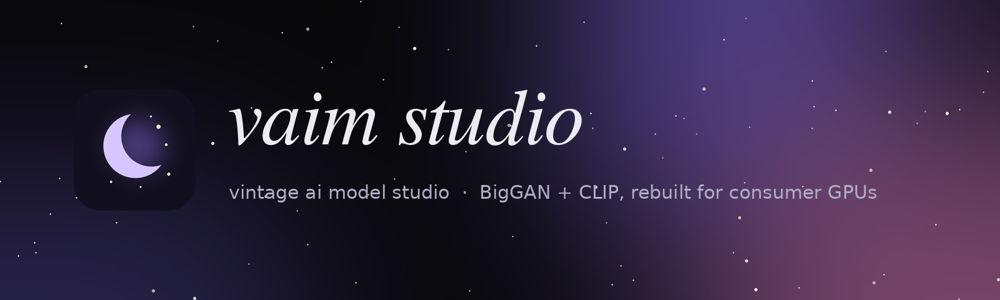

<p align="center">
  
</p>

<p align="center">
  <a href="https://github.com/Kuzuw/vaim-studio/releases/latest"></a>
  <a href="https://github.com/Kuzuw/vaim-studio/actions/workflows/ci.yml"></a>
  
  
  <a href="LICENSE"></a>
</p>

**VAIM Studio** (Vintage AI Model Studio) is a Windows desktop app for making images the way it was done in 2021:
**BigGAN-deep** steered by **CLIP**, the *Big Sleep* method by
[lucidrains](https://github.com/lucidrains/big-sleep). The engine has been rebuilt to run well on modest
NVIDIA cards, down to a 4 GB GTX 1650. The app adds Real-ESRGAN upscaling up to 4K and a modern interface.

If you like the dreamlike, slightly uncanny look of early text-to-image models, this is for you.

---

## Features

- **One-click styles**: *Sharpest*, *Balanced*, *Portrait*, *Landscape*, *Classic 2021*, *Fast draft*.
- **Output up to 4K**: BigGAN paints at 512 px, then Real-ESRGAN ×2 passes take it to 1080, 2K, 4K
  or any custom size, with an adjustable sharpness blend.
- **Render queue**: line up prompts, each with its own settings, folder and format, and walk away.
  The PC is kept awake and the taskbar flashes when a render finishes.
- **Re-dream**: continue a finished image, or start from it and drift toward a new prompt.
- **Image prompts and avoid words**, `|` to blend ideas, batched variations, fixed seeds.
- **PNG / JPEG / WebP**, with the full settings stored in every file.
- **Self-tuning engine**: measures your GPU once per setting and remembers the fastest safe setup.
- **Auto-finish**: stops when the picture stops changing.

## Install

1. Update your NVIDIA driver.
2. Download **`VAIM-Studio-Setup-x.y.z.exe`** from [Releases](https://github.com/Kuzuw/vaim-studio/releases/latest)
   and run it. No admin rights are needed. It installs a private Python with the CUDA build of PyTorch
   (~2.5 GB) and runs a self-test.
3. The first render downloads the models (~700 MB, once).

> Windows SmartScreen may warn because the installer isn't code-signed: *More info → Run anyway*.
> Uninstall from *Settings → Apps*. Your images are kept.

## Tips for good results

| Want | Do this |
|---|---|
| Maximum detail | **Sharpest** style, size **2K** |
| Faces | **Portrait** style, plus a face photo as **image prompt**. BigGAN never saw a "face" class, so this is what makes faces recognisable. |
| Natural texture | Upscale sharpness at **60-85%** (100% can look plasticky) |
| Speed | **Fast draft** to explore, then re-render the keeper. Keep the base model at **512**: the small bases are barely faster but blurry. |

## How it works

Big Sleep optimises BigGAN's latent inputs (noise plus ImageNet class mix) so that random crops of the
generated image ("cutouts") match your prompt according to CLIP. VAIM keeps that objective, with the same
losses, EMA and cutout scheme, but restructures the computation:

| Original big-sleep | VAIM Studio engine |
|---|---|
| Gradients for every BigGAN and CLIP weight | Both models frozen: backward only reaches the latents |
| Spectral norm recomputed every forward | Baked into plain weights once (identical output) |
| 128 cutouts built in a Python loop | One `grid_sample` call |
| All cutouts through CLIP at once (OOM on small cards) | Chunked CLIP passes, gradients accumulated on the image: same gradient, bounded memory |
| Per-latent Python loops, `topk(999)` sort | Vectorised losses, no sort |
| Fixed fp16 CLIP | Tuner picks precision per GPU (fp32 is ~3.4× faster on a GTX 1650) |
| OOM = crash | Checkpointing, smaller chunks, retry; VRAM cap prevents silent RAM spill on Windows |
| NaN on some cards | fp16 probe plus automatic fallback, resuming from the last good state |

`app/tools/selftest.py` checks the rewritten pieces against the **unmodified** original code
(`app/tools/legacy_biggan.py`). The same file has `--bench` to time both on your GPU.

### Measured on a GTX 1650 (4 GB)

| | |
|---|---|
| CLIP fp16 vs fp32 (512 base, 32 cutouts) | 0.44 → **1.49 it/s** |
| Step breakdown (64 cutouts) | BigGAN fwd 53 ms · **CLIP fwd+bwd 1138 ms** · BigGAN bwd 92 ms |
| Base 128 vs 256 (64 cutouts) | 0.83 vs 0.90 it/s: CLIP dominates, so use 512 |

## Build from source

Everything cross-compiles from Linux, macOS or Windows. You need Python 3.10+ and Go 1.22+.
`llvm-windres` is optional, for icon and version resources.

```bash
python scripts/build.py          # -> dist/VAIM-Studio-Setup-<version>.exe
```

Run the app directly during development (needs PyTorch, plus `pip install -r app/requirements.txt`):

```bash
python app/launch.pyw
python app/tools/selftest.py     # correctness, pipeline and UI checks
```

CI runs the self-test (CPU, off-screen UI) and builds the installer on every push. Tagging `vX.Y.Z`
publishes a release.

## Project layout

```
app/
  vaim_studio/engine/   BigGAN, CLIP, optimisation loop, autotuner, upscaler, model downloads
  vaim_studio/ui/       PySide6 window, theme, background render worker
  vaim_studio/storage.py  saving, metadata, thumbnails
  tools/                self-test & benchmark, unmodified reference BigGAN
installer/
  setup/                VAIM-Studio-Setup.exe (Go): GPU detection, uv + PyTorch install, shortcuts, uninstall
  launcher/             VAIM Studio.exe (Go): starts the app without a console
scripts/build.py        one-command installer build
```

Data lives in `%LOCALAPPDATA%\VAIM Studio` (models, settings, tuning cache, `log.txt`), images in
`Pictures\VAIM Studio` by default.

## Credits

Big Sleep by Ryan Murdock & Phil Wang · BigGAN by DeepMind (PyTorch port by Hugging Face) · CLIP by OpenAI ·
Real-ESRGAN by Xintao Wang et al. See [THIRD_PARTY_NOTICES.md](THIRD_PARTY_NOTICES.md).

Released under the [MIT License](LICENSE).
